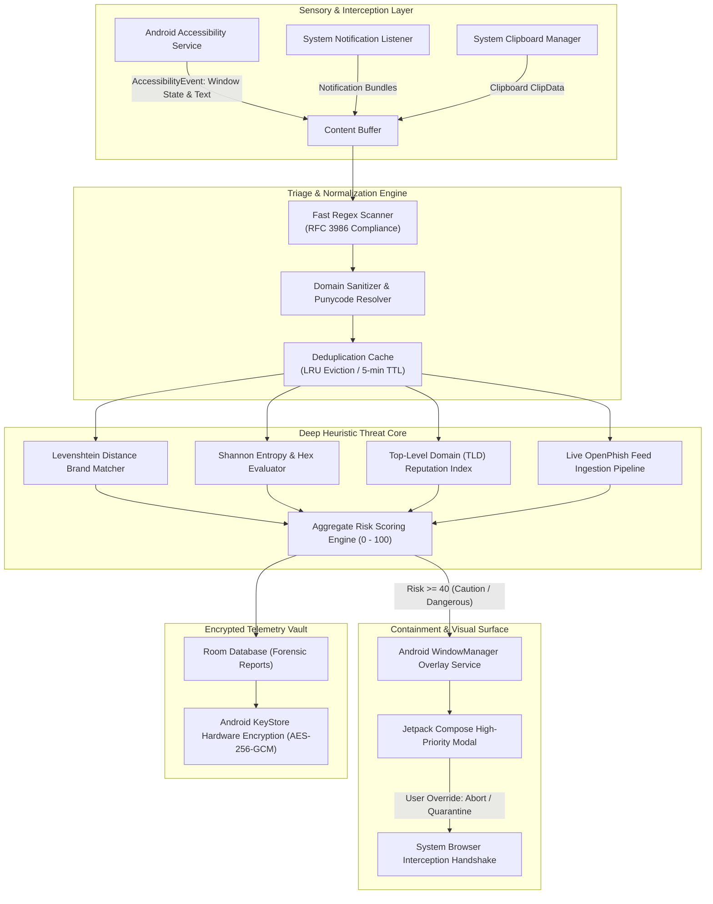
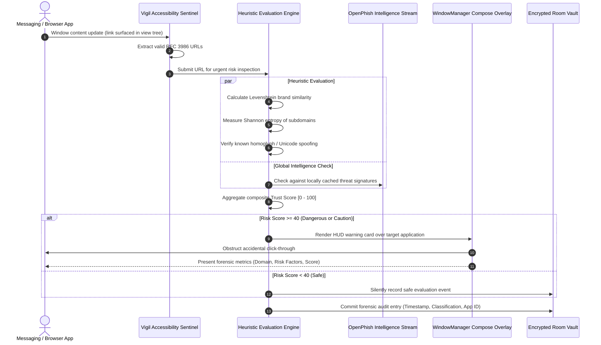

<p align="center">
  
</p>

<h1 align="center">VIGIL</h1>

<p align="center">
  <b>Autonomous Zero-Knowledge Link Intelligence & Anti-Phishing Sentinel for Android</b>
</p>

<p align="center">
  <a href="https://developer.android.com"></a>
  <a href="https://kotlinlang.org"></a>
  <a href="https://developer.android.com/jetpack/compose"></a>
  
  
  <a href="LICENSE"></a>
</p>

---

## Executive Overview

**Vigil** is an Android cybersecurity sentinel engineered to autonomously intercept, evaluate, and neutralize deceptive and malicious uniform resource locators (URLs) across messaging apps, SMS gateways, web browsers, and social communications. Built upon a strict zero-knowledge architecture, Vigil executes threat evaluation directly on-device without telemetry exfiltration or tracking user browsing activity.

By coupling real-time heuristic brand lookalike detection with live threat feeds from global intelligence aggregators (OpenPhish), Vigil neutralizes credential harvesters, zero-day spoofed domains, homograph Unicode attacks, and high-entropy shorteners before execution.

---

## System Architecture

Vigil operates across five decoupled layers engineered for sub-millisecond evaluation latency:



---

## Interception & Analysis Lifecycle

The following sequence illustrates the quarantine, analysis, and containment pipeline triggered when an incoming uniform resource identifier is surfaced on screen:



---

## Core Capabilities

### 1. Autonomous Accessibility-Driven Interception
* Continuous background monitoring of accessibility view trees across messaging clients (WhatsApp, Telegram, Signal, SMS, Slack, Discord) and web browsers.
* Native Unicode normalizer detects IDN homograph spoofing (e.g., Cyrillic characters mimicking Latin alphabets in financial domains).

### 2. Live Global Threat Feed (OpenPhish Integration)
* Direct telemetry synchronization from OpenPhish (`https://openphish.com/`).
* Real-time animated 3x5 LED dot-matrix counter displaying active phishing links, total processed URLs, and active targeted brands.
* Cached on-device with exponential backoff network synchronization.

### 3. Deep Heuristic Risk Scoring
* **Brand Lookalike Detection**: Evaluates domain substrings against high-value targets (Google, Apple, Microsoft, PayPal, Netflix, Amazon, Banking portals).
* **Shannon Entropy Analysis**: Flags generated subdomains, DGA (domain generation algorithm) links, and random phishing routing endpoints.
* **Protocol & TLD Risk Multipliers**: Inspects raw IP endpoints, deceptive ports, and high-abuse free top-level domains.

### 4. Zero-Knowledge Cryptographic Vault
* Forensic logs are committed to an encrypted Room SQLite database secured via Android KeyStore `AES-256-GCM`.
* No user link history or metadata leaves the local device.

### 5. Classified Chronological Forensics
* Historical threat logs classified under chronological headers (`TODAY`, `YESTERDAY`, and standard ISO dates).
* Instant filtering by severity: `Dangerous`, `Caution`, `Safe`, or `All`.
* Full-screen forensic investigation view detailing trust metrics, risk factors, target package names, and raw URLs.

### 6. Ultra-Lightweight Production Footprint
* Full R8 minification, Dead Code Elimination (DCE), and Android resource shrinking enabled.
* Binary footprint reduced from 63 MB to **3.54 MB** (94.4% reduction) with minimal memory consumption.

---

## Technical Specifications

| Parameter | Specification |
|:---|:---|
| **Language** | Kotlin 2.0.21 |
| **Minimum Android SDK** | API 28 (Android 9.0 Pie) |
| **Target Android SDK** | API 34 (Android 14) |
| **UI Toolkit** | Jetpack Compose (BOM 2024.09.00), Material Design 3 |
| **Architecture Pattern** | MVVM + Unidirectional Data Flow (UDF) + Clean Architecture |
| **Local Persistence** | Android Room 2.6.1 + Flow |
| **Network Client** | OkHttp 4.12.0 (Direct Socket / Jsoup HTML stream parser) |
| **Compilation Pipeline** | Android Gradle Plugin 8.7.2, R8 Minifier, ProGuard Resource Shrinker |
| **App Binary Size** | 3.54 MB release APK |

---

## Project Structure

```
Vigil/
├── app/
│   ├── build.gradle.kts           # R8 shrinking, dependencies & build configuration
│   ├── proguard-rules.pro         # Proguard preservation rules for Room & OkHttp
│   └── src/main/
│       ├── AndroidManifest.xml    # Permissions, Accessibility & Tile service configs
│       └── java/com/vigil/security/
│           ├── core/
│           │   ├── database/      # Room database, Entities & Reports DAO
│           │   ├── design/        # Custom typography, Cybernetic Color Palette, Theme
│           │   │   └── components/# DottedMatrixCounter, DottedShield, Buttons, Badges
│           │   └── security/      # Android Keystore Manager & cryptographic helpers
│           ├── service/
│           │   ├── accessibility/ # VigilAccessibilityService view tree monitor
│           │   ├── overlay/       # Jetpack Compose system WindowManager overlay
│           │   └── tile/          # Quick Settings notification toggle tile
│           ├── threatintel/       # OpenPhish scraper & heuristic threat evaluators
│           └── ui/
│               ├── home/          # Home dashboard & live telemetry matrix
│               ├── reports/       # Chronological classified incident history
│               ├── settings/      # Settings, Binding Terms & Privacy Policy
│               └── splash/        # Animated cyber shield splash transition
├── docs/
│   └── images/
│       └── logo.png               # Official Vigil transparent vector-rendered emblem
├── build.gradle.kts
├── settings.gradle.kts
└── README.md
```

---

## Getting Started

### Prerequisites
* Android Studio Ladybug (2024.2.1) or higher
* Java Development Kit (JDK) 17 or 21
* Android SDK Platforms 28 through 34 installed
* Physical device or emulator running Android 9.0+

### Cloning the Repository
```bash
git clone https://github.com/rakesh-pathuri/VIGIL.git
cd VIGIL
```

### Compiling Release APK
To compile the minified, production-grade release binary:
```bash
# Windows
.\gradlew.bat assembleRelease

# Linux / macOS
./gradlew assembleRelease
```
The optimized 3.54 MB APK will be output to:
`app/build/outputs/apk/release/app-release.apk`

### Installing via ADB
```bash
adb install -r -d app/build/outputs/apk/release/app-release.apk
```

### Required Permissions
Upon first launch, ensure the following permissions are granted via System Settings:
1. **Accessibility Service**: Required to monitor text in foreground windows for incoming links.
2. **Display over other apps**: Required for displaying the real-time HUD alert overlay when dangerous links are detected.

---

## Legal & Compliance

Vigil incorporates an automatic binding agreement framework. By installing or utilizing the software, users and operators are bound to the software terms of service, strict zero-knowledge privacy covenants, and disclaimer of heuristic warranties. For full legal text, inspect `LegalDocuments.kt` or the **Legal & Compliance** section within the application settings.

---

## Author & Maintainer

**Rakesh Pathuri**
* GitHub: [@rakesh-pathuri](https://github.com/rakesh-pathuri)
* Email: rakeshpathuri0705@gmail.com

---

## License

This project is licensed under the Apache License 2.0. See the [LICENSE](LICENSE) file for complete details.
