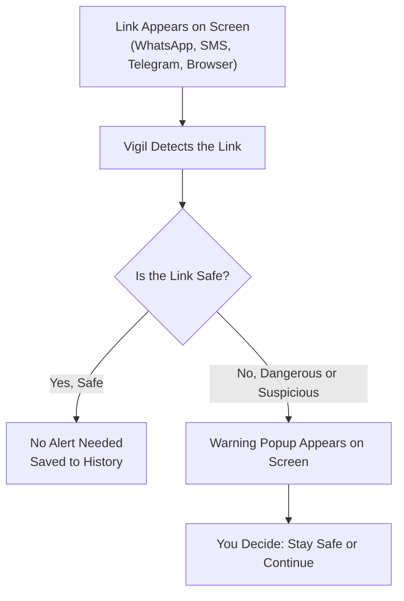
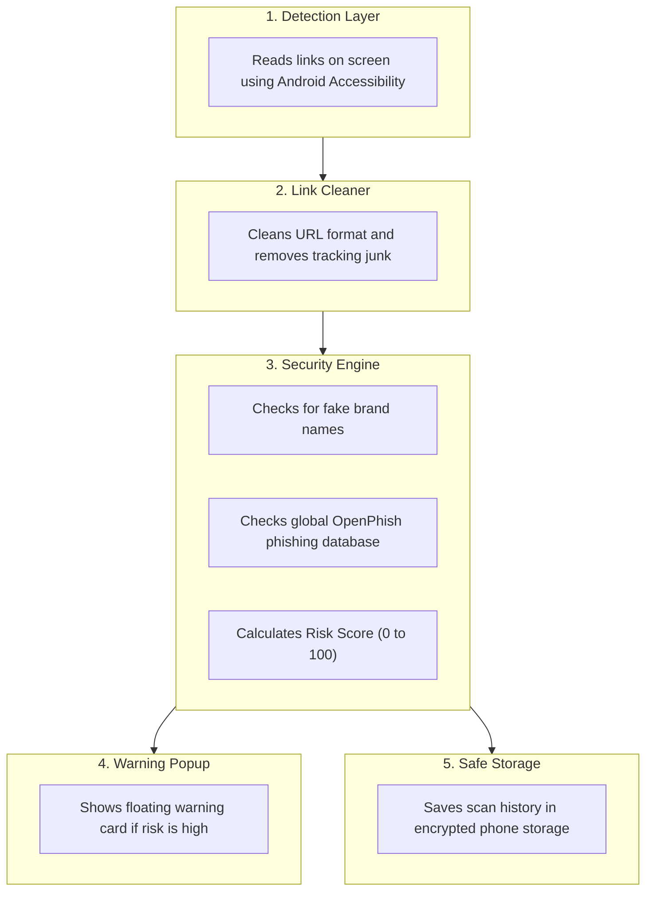

<p align="center">
  
</p>

<h1 align="center">VIGIL</h1>

<p align="center">
  <b>Smart Anti-Phishing and Safe Link Protection for Android</b>
</p>

<p align="center">
  
  
  
  
  
</p>

<p align="center">
  <a href="release/Vigil-v2.4.0.apk"><b>Download Ready-To-Install APK (Vigil-v2.4.0.apk &bull; 3.54 MB)</b></a>
</p>

---

## What is Vigil?

**Vigil** is a fast, lightweight security app for Android that protects you from fake, dangerous, and phishing links. 

When you get a message or visit a page, Vigil checks links in the background. If a link is fake (like a lookalike bank website or a scam link), Vigil warns you before you click or open it.

### Your Privacy Comes First
* **100% on your device**: All link checks happen directly on your phone.
* **No tracking**: Vigil does not collect or upload your browsing history, messages, or personal information.
* **No remote tracking servers**: Your data stays safely on your phone.

---

## How It Works

Here is a simple look at how Vigil inspects links:



---

## System Architecture

Vigil is built with 5 simple layers:



---

## Key Features

1. **Automatic Protection**  
   Runs quietly in the background. Protects you across SMS, WhatsApp, Telegram, browsers, and social apps.

2. **Real-Time Phishing Data**  
   Connects to OpenPhish to check against thousands of real active phishing sites. Includes an animated dot-matrix live counter on the home screen.

3. **Fake Brand Detection**  
   Catches lookalike domains that try to trick you (for example, fake banking, Google, or PayPal sites).

4. **Classified Incident Reports**  
   Organizes all scanned links by date (`TODAY`, `YESTERDAY`, and earlier) with quick filters: `Dangerous`, `Caution`, `Safe`, and `All`.

5. **Ultra Lightweight**  
   Optimized with Android R8 shrinking. The entire app is only **3.54 MB**, saving your phone storage and battery.

---

## App Details

| Item | Details |
|:---|:---|
| **Operating System** | Android 9.0 (API 28) and newer |
| **Language** | Kotlin 2.0 |
| **User Interface** | Jetpack Compose & Material 3 |
| **Database** | Android Room (Encrypted) |
| **App Size** | 3.54 MB |

---

## How to Build and Run

### Requirements
* Android Studio (Ladybug or newer)
* Java JDK 17 or higher
* An Android device or emulator with Android 9.0+

### Steps
1. Clone the repository:
   ```bash
   git clone https://github.com/rakesh-pathuri/VIGIL.git
   cd VIGIL
   ```

2. Build the lightweight release APK:
   ```bash
   # On Windows
   .\gradlew.bat assembleRelease

   # On Mac / Linux
   ./gradlew assembleRelease
   ```

3. Install on your device:
   ```bash
   adb install -r -d app/build/outputs/apk/release/app-release.apk
   ```

### Permissions Needed
When you open Vigil for the first time:
* **Accessibility**: Needed so Vigil can see links on your screen to protect you.
* **Display over other apps**: Needed to show the warning popup when a bad link is found.

---

## Author

**Rakesh Pathuri**  
* GitHub: [@rakesh-pathuri](https://github.com/rakesh-pathuri)  
* Email: rakeshpathuri0705@gmail.com
